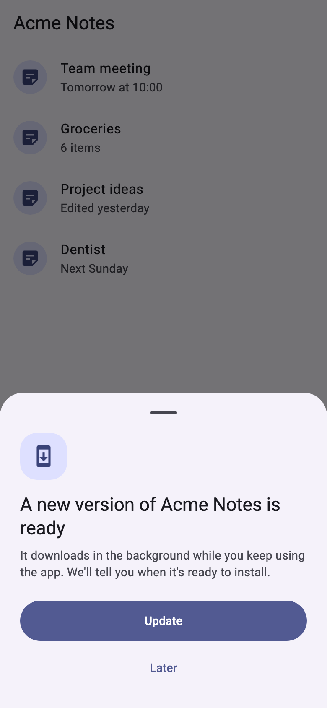
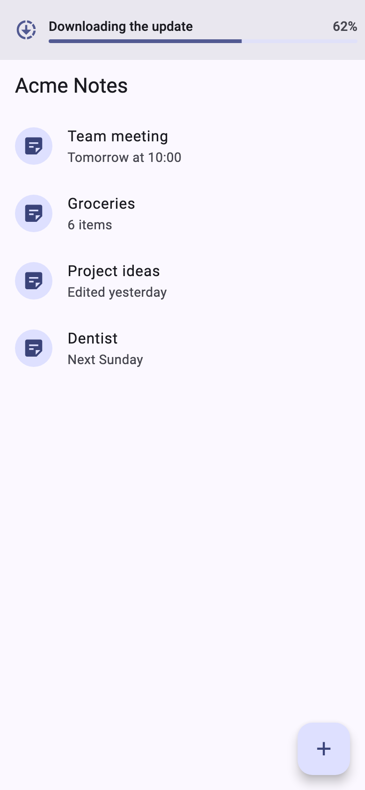
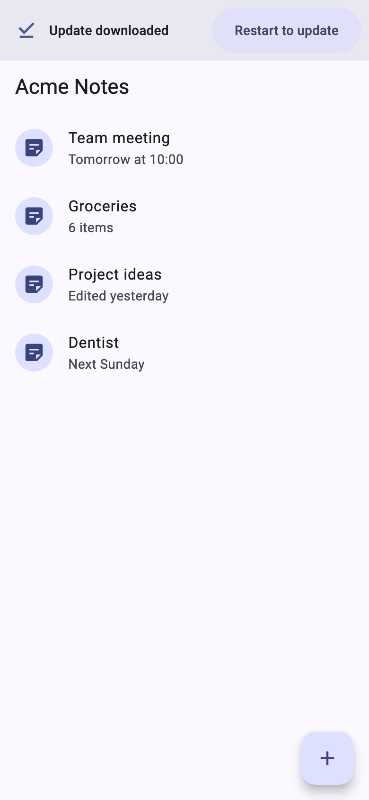
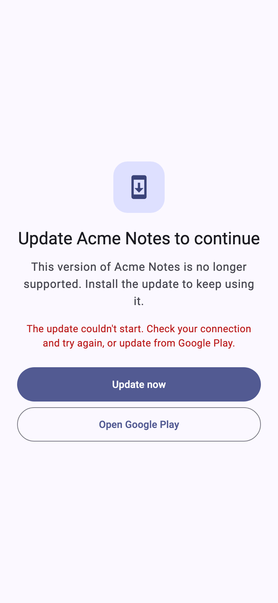
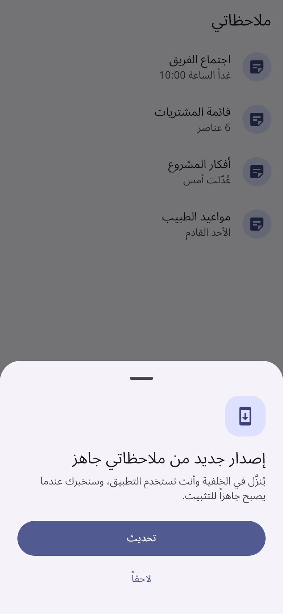
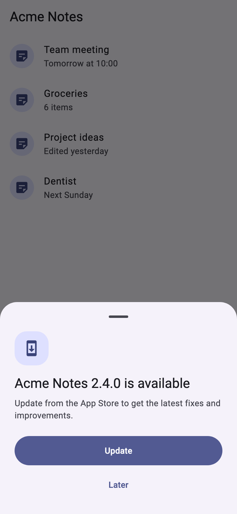

# store_update

In-app updates for Flutter. When a newer release is in the store, your users
update without leaving the app and watch the download happen.

- **Android:** Google Play In-App Updates. A required release opens Play's
  full-screen update. Any other release downloads in the background, with
  the real percentage shown in your app and then "Restart to update".
- **iOS:** iOS can't update in place, so the package checks the App Store
  version and shows the App Store page over your app.
- **Ready-made UI** in English and Arabic (right to left), styled from your
  `Theme`, with 48 dp touch targets. You can change the text or replace any part.
- **Never blocks by accident.** A failed check, no network, or a build not
  installed from the store shows nothing.

<table>
  <tr>
    <td></td>
    <td></td>
    <td></td>
  </tr>
  <tr>
    <td></td>
    <td></td>
    <td></td>
  </tr>
</table>

| | Android | iOS |
|---|---|---|
| Finds a newer version | Google Play In-App Updates (on the device, through the Play Store app) | Apple's public lookup, at most once a day |
| Required update | Play's full-screen update, then a page that waits | – |
| Optional update | Background download with progress, then restart | Opens the App Store page inside the app |
| Permissions | None | None |

## Install

```yaml
dependencies:
  store_update: ^0.1.0
```

There is no native setup. Android needs a minSdk of 24 and iOS needs 15. The
Android plugin uses the Android Gradle Plugin 9's built-in Kotlin, which is
the setup of apps created with Flutter 3.41 or later. Older AGP 8 projects
are untested.

## Use

Create one controller for the app's lifetime and put `StoreUpdateGate` in
`MaterialApp.builder`, so the update UI shows over every screen. The gate starts
checking once `enabled` is true, for example after sign-in or onboarding. It
checks again each time the app comes back to the foreground.

```dart
final updates = StoreUpdateController(
  appStoreCountry: 'us', // the App Store storefront to look in (iOS)
);
final navigatorKey = GlobalKey<NavigatorState>();

MaterialApp(
  navigatorKey: navigatorKey,
  builder: (context, child) => StoreUpdateGate(
    controller: updates,
    navigatorKey: navigatorKey,
    enabled: signedIn, // nothing is checked or shown while false
    appName: 'My App',
    child: child!,
  ),
  home: const HomeScreen(),
);
```

You can also wrap a single screen instead (`home: StoreUpdateGate(...)`). The
required-update page still covers every screen, because it opens as a route
on the root navigator. The download bar then shows only on that screen.

### When an update is offered or required

On Google Play, a release is **required** when you publish it with an in-app
update priority of 4 or 5. Everything else is optional and is offered at most
once a day. You can change both:

```dart
StoreUpdateController(
  policy: const UpdatePolicy(
    requiredPriority: 5,              // only 5 is required; 6 means never
    promptGap: Duration(hours: 72),   // offer optional updates every 3 days
  ),
);
```

| Situation | What the user sees |
|---|---|
| Optional update | A sheet: **Update** / **Later**. **Update** downloads in the background. A bar across the top shows the percentage, then **Restart to update**. |
| Required update | Play's full-screen update screen. If the user closes it, a page explains that the update is required, with **Update now** and **Open Google Play**. Back doesn't leave it. |
| Required, but Play only allows a background download | The sheet, without **Later**. |
| An update finished downloading while the app was closed | **Restart to update** on the next start. |
| No network, check failed, timeout (10 s), sideloaded build | Nothing. A required-update page that's already showing also goes away. |

Play's "staleness days" never force an update. A phone that was offline for
weeks isn't locked out.

### Your own text

The built-in text follows the app's locale: Arabic for `ar`, English
otherwise. To change some of it:

```dart
StoreUpdateGate(
  controller: updates,
  labels: (context) => StoreUpdateLabels.of(context, appName: 'My App')
      .copyWith(requiredBody: 'This version no longer works with our servers.'),
  child: const HomeScreen(),
);
```

For another language, build a `StoreUpdateLabels` yourself.

### Your own widgets

Replace any part with `offerSheetBuilder`, `progressBarBuilder` or
`requiredPageBuilder`. You can also skip the gate entirely: listen to the
controller (`phase`, `progress`, `storeVersion`) and call `accept`, `dismiss`,
`restartToInstall`, `retryImmediate` and `openStore` from your own UI.
`UpdateOfferSheet`, `UpdateProgressBar` and `RequiredUpdatePage` are public
if you want to reuse them.

## Marking a release as required (Google Play)

Play reads the priority (0–5) from the release, and it is set **when the
release is created**. It can't be changed afterwards, and the Play Console
website can't set it. Use the Publishing API, or fastlane:

```ruby
upload_to_play_store(track: "internal", aab: aab, in_app_update_priority: 5)
```

Promoting a release to another track keeps its priority. To make an update
required after the fact, upload a new build with the priority you need.

## Testing a real update

In-app updates only work in a build **installed by Google Play**. A build from
`flutter run`, a sideloaded APK, or a debug build gets no update, and the
package correctly shows nothing.

1. **Internal app sharing** (fastest, but can't set a priority):
   1. Turn on internal app sharing in the Play Store's settings on the phone.
   2. Upload a build and install it from its link.
   3. Upload a build with a higher version code and open its link, but don't
      install it.
   4. Open your app.
2. **Internal testing track** (also tests required updates):
   1. Install version N from the opt-in link.
   2. Upload N+1 with `in_app_update_priority: 5`.
   3. Wait for Play to show it to the tester, then open the app.

To try the UI without a store, run the [example](example) and pick a
simulated store from the list.

In tests, replace the store with a fake:

```dart
class FakeStore extends StoreUpdatePlatform { /* ... */ }

StoreUpdateController(platform: FakeStore());
// or, for code that uses the default controller:
StoreUpdatePlatform.instance = FakeStore();
```

## Privacy

The package sends nothing to you or to anyone else:

- **Android:** asks the Play Store app on the device.
- **iOS:** sends one request to Apple
  (`https://itunes.apple.com/lookup?bundleId=…&country=…`) with only the bundle
  id and storefront. The iOS privacy manifest declares no tracking and no
  collected data.
- **Both:** the time of the last offer is kept in `shared_preferences`, under
  keys starting with `store_update.`.

## Licence

Apache 2.0. See [LICENSE](LICENSE).
